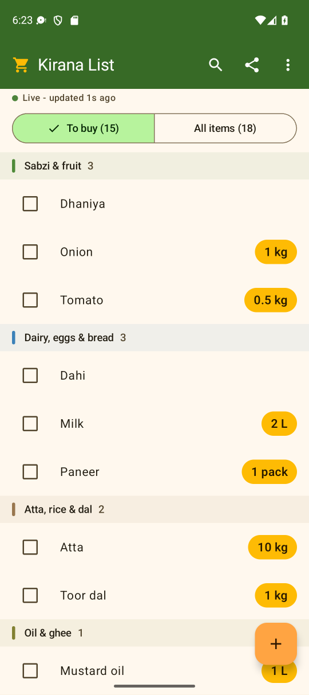
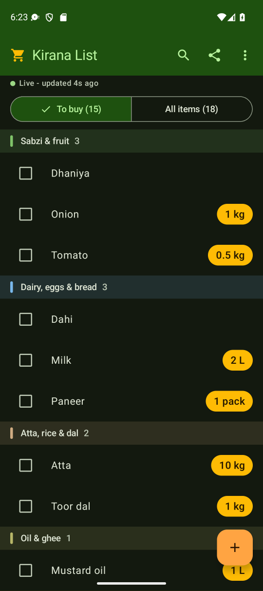

# Kirana List

*Formerly **Grocery Sync**.* The new name keeps the app id (`com.grocerysync.app`), the signing key and the sheet's script (`Code.gs` still says Grocery Sync at the top), so it installs over Grocery Sync as a normal update and keeps the list and the setup.

A shared grocery list for two phones, stored in **your own Google Sheet**. It's free: no servers, no Google Cloud project, no Play Store account.

<p align="center">
  
  &nbsp;
  
</p>

- One person at home adds items or marks them as needed. The person in the shop sees the change within a few seconds and ticks items off.
- Start your list in a minute: **Add common items** offers built-in sets of common Indian items (Everyday, Monthly kirana, Diwali puja, Vrat / fasting) to tick, each with a usual unit (Atta kg, Milk L, Eggs dozen, spices pack).
- Got a list as a WhatsApp message or a note? Paste it (or share it to Kirana List) and add every item at once, after a preview of what each line does.
- **Share** sends what's on To buy as a message (WhatsApp, SMS, ...): *Grocery list (3 items)*, then *• Atta - 10 kg*, *• Dahi*, under shop section headings. Pasted into Kirana List on another phone, it gives the same items and amounts.
- Each item is either **Yes / no** or a **Quantity**: an amount and a unit, so the shopper knows exactly what to buy ("Rice 2 kg", "Milk 1.5 L"; 0 = don't need). You can switch an item between the two any time.
- Each item says who added or last changed it, and when ("Added by Home - 2 hours ago", "Updated by Shop - 5 minutes ago"). Search finds an item by part of its name on either list, or by its other name in English or Hindi ("curd" finds Dahi, "pyaaz" or "प्याज" finds Onion), and you swipe between **To buy** and **All items**. Adding "Curd" while "Dahi" is on the list points that out (it doesn't stop you).
- **To buy** is grouped by shop section, in the order you walk through the shops: Sabzi & fruit; Dairy, eggs & bread; Meat & fish; Atta, rice & dal; Oil & ghee; Masala; ... and Other last. The app knows the section of common Indian grocery items in English and Hindi (built from [the common Indian grocery list](docs/indian-grocery-list.md)). Each phone can move an item to another section, or show To buy A to Z.
- It works offline. Changes are saved on the phone and sync when the connection is back. If both people change the same item, the most recent change wins.
- The sheet stays a normal, readable spreadsheet, and you can edit it by hand too.

```
 Phone A ─┐                                         ┌─ "Items" tab   (the shared list)
          ├─ HTTPS ─► Apps Script web app (free) ───┼─ "History" tab (who changed what)
 Phone B ─┘   (each phone checks every ~5 s         └─ hidden "_Tombstones" tab (deleted items)
               while the app is open)
```

---

## 1. Set up the Google Sheet (once, about 5 minutes)

Use a **personal Google account**. Work and school Google accounts often block "Anyone" web apps.

1. Create a new Google Sheet, for example "Groceries".
2. **Extensions → Apps Script**. Replace everything in `Code.gs` with the contents of [`apps-script/Code.gs`](apps-script/Code.gs) and save (💾).
3. Near the top, change `SECRET_TOKEN: 'CHANGE_ME'` to your own long random secret and save again.
   *Tip:* choose `generateToken` in the function dropdown, click **Run**, and copy the token from the Execution log.
4. Choose `setupSheets` in the dropdown and click **Run**. Google asks you to authorize the script: pick your account, then **Advanced → Go to … (unsafe) → Allow**. The warning appears because this is your own unverified script. The **Items** and **History** tabs are created, plus a hidden **_Tombstones** tab.
5. **Deploy → New deployment**. Click the ⚙️ icon, choose **Web app**, then set:
   - **Execute as:** Me
   - **Who has access:** Anyone
6. Click **Deploy** and copy the **Web app URL**. It ends in `/exec`.

> "Anyone" means anyone who has the URL can call it. The secret token is what keeps strangers out, so keep both private.

**Changed `Code.gs` later (including a new token)?** Changes don't go live until you choose **Deploy → Manage deployments → ✏️ → Version: New version → Deploy**. The URL stays the same.

**Updating to a newer `Code.gs`:**
1. Copy your current token from the `SECRET_TOKEN: '…'` line.
2. Replace everything in `Code.gs` with the new file.
3. Put your token back into `SECRET_TOKEN`, then save.
4. Deploy a **New version** as above.

The new file comes with `'CHANGE_ME'`, so skipping step 3 makes the app report *The script still has SECRET_TOKEN = 'CHANGE_ME'*.

Coming from version 1.3? Version 1.4 changes only the app: install it over 1.3 on both phones (section 2); the sheet and `Code.gs` stay as they are. Coming from version 1.1? Follow [Updating to 1.2](#updating-to-12) below. Coming from a version without units? Follow [Updating to amounts with units](#updating-to-amounts-with-units).

## 2. Install the app on both phones

Use **Option C** (the signed release APK) for the two phones you shop with. Options A and B install a *debug* build, which is for development and trying things out: anyone who has the phone and turns on USB debugging can read a debug app's private storage, the secret token included.

**Option A: Android Studio** (development only)
1. In Android Studio, **File → Open** the `android/` folder.
2. Plug in a phone with USB debugging on and press **Run ▶**.

**Option B: build a debug APK and share it** (development only; needs JDK 17 or newer; Android Studio's bundled JDK works)

```bash
cd android
./gradlew assembleDebug
```

That works on macOS, Linux and in Git Bash on Windows. In Windows PowerShell, run `.\gradlew.bat assembleDebug`; in Command Prompt (cmd), run `gradlew.bat assembleDebug`.

Copy `android/app/build/outputs/apk/debug/app-debug.apk` to each phone, for example over WhatsApp or Google Drive, and open it. Allow "install unknown apps" when asked.

**Option C: a signed release APK** (recommended for the phones; smaller and faster than the debug one, and its storage can't be read over USB debugging)

```bash
cd android
./gradlew assembleRelease
```

The APK is `android/app/build/outputs/apk/release/app-release.apk`. Share it the same way as in Option B.

The build signs it with a key that lives outside the project. It reads the key's details from `keys/grocery-sync-release.properties` in your home folder (on Windows `C:\Users\<you>\keys\`). To use another file, set the `GROCERY_SYNC_SIGNING` environment variable to its path. If the file is missing, the build still succeeds, but the APK is unsigned and phones won't install it.

Making a key on a new computer (once), with the `keytool` that comes with any JDK:

```bash
mkdir -p ~/keys && cd ~/keys
keytool -genkeypair -keystore grocery-sync-release.jks -storetype PKCS12 -alias grocerysync -keyalg RSA -keysize 4096 -validity 10000 -dname "CN=Grocery Sync"
```

Then create `grocery-sync-release.properties` next to it with these lines, using the password you chose:

```properties
storeFile=grocery-sync-release.jks
storePassword=<your password>
keyAlias=grocerysync
keyPassword=<your password>
```

> **Back up the `keys` folder** (both files). Every later release must be signed with the same key, or Android refuses to install it over the app already on the phone. Losing it means uninstalling and setting the phones up again.

**Version numbers.** Before building a release for the phones, raise `versionCode` (by 1) and `versionName` (e.g. 1.2 → 1.3) in `android/app/build.gradle.kts`. Android only installs an update over the app if its `versionCode` is the same or higher. The bottom of **Settings** shows the version installed on that phone (e.g. *Version 1.2*).

### Switching from the debug app to the release app (once)

The debug APK and the release APK are signed with different keys, so Android won't install one over the other. Switch each phone like this:

1. Make sure nothing is waiting to be sent: the status line under the title says *Live*, and no banner mentions items waiting on this phone.
2. Have the **Web app URL** and the **secret token** at hand. The token is the `SECRET_TOKEN` line of `Code.gs` in Apps Script (the app never shows it). A setup message you kept from an older version works too.
3. Uninstall the app (**Kirana List**, called **Grocery Sync** in older versions): long-press the icon → **Uninstall**.
4. Install `app-release.apk`.
5. Open the app and tap **Set up**. Either copy the setup message you kept and tap **Paste setup code**, or type the **Web app URL** and the **Secret token**. Enter your name and tap **Save**. The list comes back from the sheet.

Later releases signed with the same key install over the app as normal updates, keeping the setup.

## 3. Connect the phones

**First phone**
1. Open **Kirana List** and tap **Set up**.
2. Enter **Your name** (the other person sees it, e.g. "Added by Home"), the **Web app URL** and the **Secret token**.
3. Tap **Test connection**. It should say *Connected to Groceries* (your sheet's name). Then tap **Save**.

**Second phone**
1. Open **Kirana List** and tap **Set up**.
2. Enter **Your name**, the **Web app URL** and the **Secret token** (the `SECRET_TOKEN` from `Code.gs`). Kept a setup message from an older version? Copy it and tap **Paste setup code** instead of typing the URL and token.
3. Tap **Test connection**, then **Save**.

> The app never shows the token, and you can't copy it out of the app. Once saved, the **Secret token** field is empty and says *Saved and hidden*. To change the token, type or paste a new one; leave the field empty to keep the saved one. The hidden token is only ever sent to the **Web app URL** it was saved with: if you change the URL, type or paste the token again (the field says so), so nobody can point the app at another address to get the token out. A setup message pasted into the token field is read as a setup code. Anyone with the URL and the token (or a setup message) can edit your list, so keep them private.

## Updating to 1.5 (Kirana List)

Version 1.5 is 1.4 with a new name and look: **Kirana List** (it was Grocery Sync), a new icon (a cream cloth bag with a turmeric tick on green), deep green app bars, turmeric amounts, a marigold **+** and a colour mark for each shop section on **To buy** (see *Look and name* in [docs/README.md](docs/README.md)). **Share** no longer offers the app itself in the share sheet.

- **Install 1.5 over 1.4** on both phones (section 2), as a normal update. Don't uninstall first: the list, your name, the web app URL and the hidden token stay, and so do changes that haven't been sent yet. The icon and its name change to **Kirana List**.
- **The sheet and `Code.gs` stay as they are.** 1.5 changes nothing in the script or the sheet, so there is nothing to redeploy, and a phone still on 1.4 keeps working with one on 1.5.

## Updating to 1.2

Version 1.2 adds search, swiping between the lists, "Added by" / "Updated by" on every item, unique item names, a unit for every quantity, a hidden secret token, and the version number at the bottom of Settings. "Share setup with another phone" is gone. Update the sheet first, then the phones:

1. **Update the script.** Follow *Updating to a newer `Code.gs`* in section 1: copy your token, paste the new `Code.gs`, put the token back, save, and deploy a **New version** (**Deploy → Manage deployments → ✏️ → Version: New version → Deploy**). You don't need to run `setupSheets`. The first change from a phone adds an **Added At** column right after **Updated By** on the Items tab (running `setupSheets` adds it too). Columns of your own to the right of Updated By move one column to the right, with their cells. (One exception: a column of your own right after Updated By that holds nothing but dates pasted from Updated At, in its *yyyy-mm-dd hh:mm:ss* format, looks just like the script's Added At with its title changed, and is used as Added At. Move such a column further right, or give it another date format, before the update.)
2. **Install 1.2 over 1.1 on both phones** (section 2). Don't uninstall first: the app upgrades its saved list and keeps changes that haven't been sent yet. (Moving from the debug APK to the signed release APK at the same time is the exception: follow *Switching from the debug app to the release app*.) Android won't install 1.1 over 1.2.

The phones can be updated in any order:

- **The 1.1 app with the new script** keeps working; it simply doesn't show "Added by". Items it adds still get their Added At.
- **The 1.2 app with the 1.1 script** keeps working too, but says "Updated by" for everything (an item just added on that phone says "Added by" for a few seconds, until it syncs).
- Until the new script is deployed, items added get no Added At and always say "Updated by".

Items that were on the list before 1.2 say "Updated by", because the sheet doesn't know when they were added. Renaming an item, or bringing a deleted one back with **Undo**, keeps the time it was added, so it says "Updated by" too. For an item from before 1.2, whose Added At isn't known, the renamed (or restored) row gets the time the item was last changed before instead, the earliest time it is known to have been on the list. Quantities from before units have no unit: the next time you open one, choose a unit (see *Amounts and units* under [Using it](#using-it)).

## Updating to amounts with units

Already using the app from before units existed (quantities were whole numbers only)? Both phones need the new app, and the sheet needs the new `Code.gs`. Update the sheet first:

1. **Update the script.** Follow *Updating to a newer `Code.gs`* in section 1: copy your token, paste the new `Code.gs`, put the token back, save, and deploy a **New version**. Saving alone isn't enough: the phones keep talking to the old version until you deploy.
2. **Optional, after deploying:** choose `setupSheets` in the function dropdown and click **Run**. It adds the **Unit** column right after **Need** on the Items and History tabs. If you skip this, the first change from a phone adds the column. Either way every value, checkbox and note stays with its item, and the new column is added only once. Deploy before you run it: until you deploy, the phones still talk to the old script, which writes its columns in the old order. (If that happens anyway, those rows are still read correctly and are rewritten in the new order the next time they change.)
   - Already had a column of your own titled **Unit**? It's moved next to **Need** and its units are used.
   - Have a **Type** dropdown of your own that allows `integer`? `quantity` is added to its list, because the script now writes `quantity`.
3. **Install the new app on both phones** (section 2). Install it over the old app; don't uninstall first, because that deletes the saved setup and any changes that haven't been sent yet. The one exception is moving from the debug APK to the signed release APK at the same time: follow *Switching from the debug app to the release app* in section 2 instead.

The new app has a higher version number, so Android won't install the old app over it. Going back to the old app means uninstalling first, which loses the setup and any changes that haven't been sent yet.

Your existing quantities keep their numbers and start without a unit. Add units in the app (tap the item) or type them into the sheet.

While only some of this is updated:

- **An old app with the new script** keeps working. It shows each amount rounded up to a whole number (1.5 kg shows as 2, so it still counts as needed) and its changes keep the item's unit.
- **The new app with an old script** keeps showing the list, but a banner says *The sheet's script is out of date. To use units, paste the latest Code.gs into Apps Script and deploy a new version.* and how many items are waiting. Changes made on that phone are kept and go out by themselves once the new script is deployed. Nothing is lost.

## Using it

| You want to… | Do this |
|---|---|
| Add an item | Tap **+**, type the name, choose **Yes / no** or **Quantity**. For a quantity, set **How much to buy?** and choose a unit (see below). **Save** turns on once every field has a value. New items start as *not needed* and show up under **All items**, which is handy for building your usual list once. |
| Start your list quickly | On the empty list tap **Add common items** (or **⋮ > Add common items** any time). Pick a set (**Everyday**, **Monthly kirana**, **Diwali puja**, **Vrat / fasting** or **All**). Its items start ticked, except meat, fish and eggs: tick those if your family buys them. Untick what you don't buy and tap **Add N items**; changed your mind? Tap **Undo** on the message that follows. They go to **All items**, not needed, each with a usual unit (Atta kg, Milk L, Eggs dozen, spices pack) or as yes / no. Items already on the list, also under another name (Curd for Dahi), can't be ticked. It works once the family's list has loaded from the sheet (right after setup it says *Wait until your list has loaded from the sheet*), so nothing replaces the family's items of the same name. The items come from [the common Indian grocery list](docs/indian-grocery-list.md). |
| Add an item that's already there | Names are unique: the same name with other capitals or spaces is the same item. The dialog says *"Rice" is already on the list* and offers **Open "Rice"** to edit that item instead, so nobody overwrites the other person's item (and its amount) by adding it again. The app checks again as it saves, so an item that reaches this phone while the dialog is open isn't overwritten either; neither is one that took the name before you tap **Undo** after a delete. The exception: an item the other phone added that this phone hasn't received yet, because it was offline or the item is only seconds old. Then both phones changed the same item and the most recent change wins (the **History** tab keeps both). Another name for the same thing is only pointed out, not blocked: adding "Curd" while "Dahi" is on the list says *Similar: "Dahi" is already on the list* and offers **Open "Dahi"**, but **Save** still adds Curd. Renaming an item to such a name shows the same warning. |
| Find an item | Tap the magnifier (**Search items**) at the top. A search field opens under the **To buy / All items** buttons and searches the list you're on: **To buy** shows the items you need that match, **All items** every item that matches. Type part of the name: capitals, accents and apostrophes don't matter ("creme" finds "Crème fraîche", "lays" finds "Lay's"), and every word you type must be in the name, in any order ("rice basmati" finds "Basmati rice"). Another name of the item works too, in English or Hindi (Roman or Devanagari): "curd" finds "Dahi", "pyaaz" or "प्याज" finds "Onion", "raisins" finds "Kishmish". These names come from a built-in list of common Indian grocery items, and they only match at the start of a word, so "dal" doesn't find "Cinnamon" (Dalchini). Results are A to Z, and you can tick **Got it**, flip **Need**, use **−** / **+** or tap an item as usual. Switching lists (tap or swipe) keeps the search and shows what matches on the other list. Nothing to buy matches, but the item is on the list (not needed right now)? Tap **Show 2 in All items** (or however many match) to see it there. Nothing found at all? Tap **Add "…" to the list** to add it with that name. The **X** (or Back) closes the search. |
| Switch lists | Tap **To buy** / **All items**, or swipe left or right. Each list keeps its scroll position. |
| Mark something as needed | In **All items**, flip **Need** on, or use **+** to set a quantity. Tap the amount to type an exact one. |
| Add a list at once (paste) | Copy a list (a WhatsApp message, a note, a list shared from Kirana List), choose **Paste a list** in the **⋮** menu, tap **Paste**, then **Next**. Or pick **Kirana List** in another app's **Share** menu: the same preview opens with the shared text (nothing changes before you confirm). One item per line: "Rice 2 kg", "2 kg rice", "Rice - 2kg", "Rice x2", "Milk 1/2 L" or just "Dahi"; bullets, numbers, check boxes and WhatsApp formatting don't matter. The preview says what each line does: **Add Rice - 2 kg** (a new item, needed; without an amount it is yes / no, and a number without a unit counts pieces), **Mark Dahi needed** (also when the line uses another name of it: "Curd → Dahi"), **Already needed: Oil**, or **Change Rice 2 kg → 3 kg** (only if you tick it). Lines it can't use are skipped with the reason, such as an amount in another unit than the item's (nothing is converted); a yes / no item takes no amount, and the row says so. A line all in bold that names nothing the app knows, like *\*Sabzi\**, looks like a heading and starts unticked. Untick what you don't want; the button says what it does (**Add 5 items**, **Update 3 items**, **Apply 8 changes**). Up to 200 lines. It works once the family's list has loaded from the sheet: a list shared right after setup shows its preview, and its button turns on once the list is there. |
| Shop | Open the **To buy** tab and tick **Got it** as you go. Items are grouped by shop section (Sabzi & fruit first, Other last, A to Z inside each), and the section's name and count stay at the top while you scroll through it. Each section has its own colour mark (leaf green for sabzi, blue for dairy, haldi for masala, ...), the same in **Add common items** and the item's **Shop section** picker. A search shows its results A to Z, without sections. Each quantity shows its amount and unit, e.g. **2 kg**. **Got it** sets the amount to 0 and keeps the unit. Made a mistake? Tap **Undo**. |
| Send the list to someone | Tap **Share list** (the share icon at the top) and pick WhatsApp, Messages or any other app. The message has everything on **To buy**, whatever the search shows: *Grocery list (3 items)*, then one item per line with its amount (*• Atta - 10 kg*, *• Dahi*), under shop section headings in WhatsApp bold (*\*Dairy, eggs & bread\**), or A to Z when **⋮ > Group by shop section** is off. With nothing to buy, the app says *Nothing to buy right now* instead. |
| Put an item in another shop section | Tap the item, pick its **Shop section** and **Save**. This changes only this phone's To buy: the other phone keeps its own sections, and nothing changes in the sheet. Picking the section the app chose itself goes back to the app's choice. To see To buy A to Z, turn off **⋮ > Group by shop section**. |
| Rename, change the type, amount or unit, or delete | Tap the item. A name another item already has isn't accepted (*Another item is already called "Rice"*); changing only its capitals is fine. |
| See who changed what | Each item in **All items** says who added or last changed it, and when: "Added by Home - 2 hours ago" until someone changes it, then "Updated by Shop - 5 minutes ago". Times are in words: just now, 3 minutes ago, 2 hours ago, yesterday, 4 days ago, then the date ("on 3 Nov"). The text wraps onto another line rather than hiding the time. Fresh changes from the other person are highlighted (in **To buy** too, as "Updated by Home"). The **History** tab in the sheet has the full log. |
| Refresh right now | Pull the list down. |
| Open Settings | Tap **⋮** (More options) at the top, then **Settings**. |

**Amounts and units**

- **Units:** pick **pcs**, **kg**, **g**, **L**, **ml**, **dozen** or **pack**, or choose **Other...** and type your own, such as *bunch*, *box* or *bottle* (up to 16 characters). Usual spellings become the standard unit: "Kgs" or "kilo" becomes **kg**, "litres" becomes **L**, "pieces" becomes **pcs**.
- **Every quantity needs a unit.** There is no default: a new quantity (also one added from the search, or a yes / no item switched to a quantity) starts without one, the unit picker says *Choose a unit*, and **Save** stays off until you pick one. Quantities from before units have no unit and show as "× 2" in the list; their dialog asks you to choose one too.
- **Decimals** are fine, up to 3 places: 1.5 kg, 0.5 L, 2.25 kg. A comma works too (1,5).
- **The − / + buttons** step by **0.5** for kg and L, by **100** for g and ml, and by **1** for pcs, dozen, pack and your own units. **−** never goes below 0, and 0 means "not needed".

The status line under the title shows **Live - updated 3s ago** while syncing works. Your changes are kept on the phone and sent later when it shows one of these:

- **Offline - showing saved list**: the phone can't reach Google.
- **Sheet busy - retrying**: someone else's change is being saved.
- **Google isn't responding - retrying**: Google is having a problem.
- **Sheet error - retrying: …**: the script answered with an error; its own words follow.

If the list still updates but your changes can't be saved, the status stays **Live** and a red **Changes aren't saving** line under it shows the reason. The app keeps retrying in the background; tap **Retry** to send right away.

If the sheet still runs a `Code.gs` from before units, a line under the status says **The sheet's script is out of date.** and how many items are waiting. The list keeps updating, and your changes stay on the phone until the new script is deployed (see [Updating to amounts with units](#updating-to-amounts-with-units)).

A row with a ↻ icon hasn't synced yet.

## What the sheet looks like

**Items** has one row per item. You can edit it by hand: change a value, tick a checkbox, pick a unit, or add a row. The app picks up the change within seconds.

| Item | Need | Unit | Type | Updated At | Updated By | Added At |
|---|---|---|---|---|---|---|
| Rice | 2 | kg | quantity | 2026-11-07 18:05:12 | Home | 2026-11-07 18:05:12 |
| Milk | 1.5 | L | quantity | 2026-11-07 18:05:30 | Home | 2026-11-02 09:14:03 |
| Coriander | 1 | bunch | quantity | 2026-11-07 18:06:02 | Shopper | 2026-11-07 18:06:02 |
| Bread | ☑ | | boolean | 2026-11-07 18:06:40 | Home | |
| Coffee | ☐ | | boolean | 2026-11-07 09:00:00 | Shopper | 2026-10-30 19:20:45 |

- **Need** is a checkbox for `boolean` (yes / no) rows and the amount for `quantity` rows (0 = not needed).
- **Unit** has a dropdown with the standard units on quantity rows. It only warns about other units and never refuses them, so you can type your own. Yes / no rows leave Unit empty.
- **Type** is written as `boolean` or `quantity`. Rows from before units say `integer`; they are read as quantities, so you don't need to change them.
- **Added At** is when the item was added, in the same date format as Updated At. The script fills it in when a phone adds the item, and when you type a new item into the sheet: into an empty row, or into an Item cell you cleared earlier (the new item doesn't take over the removed one's date). While you fill in the other cells of a row you typed (Need, Unit, Type) within 10 minutes, it moves along with Updated At, so the item still says "Added by Sheet". After that it never changes. Rows from before 1.2 leave it empty (not known); renaming one of those in the app (or Undo after deleting it) writes the time it was last changed before.
- The phones show **"Added by"** while Added At equals Updated At, i.e. nobody has changed the item since it was added ("Added by Home" for Rice, "Added by Shopper" for Coriander), and **"Updated by"** otherwise (Milk, Coffee, and Bread, whose Added At isn't known).

**History** gets one row per change: Time, Item, Action, Need, Unit, Type, By and Change ID. To turn it off, set `KEEP_HISTORY: false`.

**Editing by hand: rules**

- **To remove an item, delete it in the app, or clear its Item cell.** Don't delete the whole row: Google sends no notification for row deletions, so a phone that was offline could bring the item back.
- Amounts can have up to 3 decimals (more are rounded). In a quantity row, "1,5" typed into Need is read as 1.5, and "2 kg" as 2 kg while the Unit cell is empty. A comma followed by three digits separates thousands: "1,000 ml" is 1000 ml and "1,00,000" is 100000. Text the script can't read safely, such as "0,500", counts as 0.
- Units are cleaned up the same way as in the app: "Kgs" in the Unit cell shows as **kg** on the phones.
- Editing Item, Need, Unit or Type stamps *Updated At* and *Updated By*. A new item you type in also gets *Added At* (see above).
- Leave **Added At** as it is: it is only written when a row is created.
- Inserting, deleting or sorting rows is safest while nobody is changing the list in the app.
- Don't rename the header columns, and keep Item, Need, Unit, Type, Updated At, Updated By and Added At next to each other. Put columns of your own to the right of them. (A cleared or renamed Added At title is still recognised once that column holds the script's dates. Renamed while it is still empty, a new Added At column is added before it; nothing is lost. The flip side: while the sheet has no Added At column, a column of your own right after Updated By that holds only dates in the script's format is taken for it.)
- Once items exist, don't change the spreadsheet's time zone (File → Settings), because stored times would shift.

## Troubleshooting

| The app says… | Fix |
|---|---|
| *Google returned a web page instead of data* | The deployment's **Who has access** isn't **Anyone**. Fix it in Deploy → Manage deployments → ✏️. |
| *The secret token doesn't match SECRET_TOKEN in the script* | The token in the app ≠ `SECRET_TOKEN` in `Code.gs`. Or you changed the token without deploying a **New version**. |
| *The script still has SECRET_TOKEN = 'CHANGE_ME'* | Set your own token, then deploy a new version. |
| *Web app not found (404)* | Wrong URL. Copy the `/exec` URL again from Deploy → Manage deployments (not the `/dev` one). |
| *Google can't open this web app ("Sorry, unable to open the file at this time")* | The deployment was deleted, or the URL is cut short. Copy the `/exec` URL again from Deploy → Manage deployments and paste it in Settings. |
| *The sheet's script failed: …* | The script crashed before it could answer. The text after the colon comes from Google. If it doesn't go away, open Apps Script → Executions to see the error. |
| **Offline** for a long time | Check the phone's internet. Changes stay on the phone and go out automatically. |
| *N changes couldn't be saved* | The sheet rejected them (the reason is shown). Tap **Retry** or **Discard**. |
| *The sheet refused this change: … (data validation on the Type column of the Items sheet)* | A data validation rule set to **Reject the input** blocks the script's write. The script writes Type as `boolean` / `quantity` in lower case, and the sheet compares the dropdown's values exactly, so a dropdown that allows only *Boolean* and *Integer* refuses them. (When the script added the Unit column, it added `quantity` to a Type dropdown that allowed `integer`.) Remove or relax the rule (select the column → Data → Data validation), or make sure it allows `boolean` and `quantity`, then tap **Retry**. Running `setupSheets` lists such rules in the Execution log. |
| **The sheet's script is out of date.** … *N items are waiting on this phone until then.* | The sheet still runs a `Code.gs` from before units. Paste the latest `Code.gs`, put your token back, and deploy a **New version** (see [Updating to amounts with units](#updating-to-amounts-with-units)). The waiting changes then go out by themselves. If you already pasted it, you probably skipped the deploy step. **Test connection** in Settings shows the same warning. |
| The other phone shows whole numbers and no units | That phone still runs the old app. It keeps working (amounts rounded up, units kept), but install the new app on it to see units. |
| Every item says "Updated by", even ones just added | The sheet still runs the `Code.gs` of 1.1, which doesn't record when items are added. Paste the latest `Code.gs`, put your token back, and deploy a **New version** (see [Updating to 1.2](#updating-to-12)). Items that were on the list before keep saying "Updated by". |
| **Save** stays off in the item dialog | Every field needs a value: a name that no other item has (the dialog names the item that has it) and, for a quantity, a valid amount and a unit (*Choose a unit*). |
| **Changes aren't saving** with *The sheet's script reported an error: …* | The script hit an error while saving (the list still updates). The text after the colon says what to fix. For example, *keep the columns Item, Need, Unit, Type, Updated At, Updated By and Added At of the Items sheet next to each other: column C is between them* means a column was inserted among them: move it to the right of them. Running `setupSheets` shows the same message in the Execution log. Your changes wait on the phone and go out once it's fixed. |

## Good to know

- **"Live" means the app checks every ~5 seconds while it's open.** Apps Script can't push updates to a phone, so polling is the free way to get near-real-time. In tests, a change from the other phone appeared in about 2-5 seconds. When the app is closed it stops checking, so it doesn't drain the battery. Unsent changes are still delivered in the background.
- **Cost:** everything here is free, and Apps Script's free limits are far beyond what two phones need. Publishing on the Play Store would cost a one-time $25. Sharing the APK costs nothing.
- **Editing the sheet by hand** works because `Code.gs` includes an `onEdit` trigger that stamps *Updated At* and *Updated By = Sheet* on edited rows (and *Added At* on new ones). That only works when the script was created from the sheet (Extensions → Apps Script).
- **Privacy:** the token is stored only in the app's private storage and is excluded from Android backups and device-to-device transfer. With the release build (Option C), other apps and USB debugging can't read that storage; a debug build's can be read over USB debugging. The app never shows, copies or shares the token, only sends it to the Web app URL it was saved with, and no longer makes setup messages.
- **Which version is on a phone?** The bottom of **Settings** (**⋮** > **Settings**) says, e.g. *Version 1.2*.

## Project layout

```
android/                   Android app: Kotlin, Jetpack Compose, WorkManager, OkHttp, SQLite
apps-script/Code.gs        The script you paste into your sheet
apps-script/test/          Offline tests for the script (with a fake Apps Script runtime) + a local mock of the web app
android/app/src/androidTest/  UI tests: the real app on an emulator against a fake web app inside the test APK
tools/e2e/                 Emulator helper scripts (Git Bash): emulator, mock, qa build, UI tests, taps and checks
docs/                      Planning notes: feature ideas, common Indian grocery list, removing the setup; the app's look (palette, icon)
```

## Testing

How much to run depends on the change:

| Change | Run |
|---|---|
| Small change (a fix, a text, a test) | Unit tests, node tests and UI tests, plus a targeted check of what changed on the emulator. |
| App feature | The same, plus one focused review of the change and the **qa smoke test**. |
| Sheet or database change (`Code.gs`, columns, the app's database version) | The same, plus the **upgrade test**, with the mock switching scripts. |

The commands (Git Bash, from the repository root; `tools/e2e/README.md` has the details):

```bash
(cd android && ./gradlew testDebugUnitTest lintDebug)   # unit tests and lint
node --test apps-script/test/                         # the script and the mock web app
tools/e2e/emu.sh && tools/e2e/uitest.sh               # UI tests on the emulator (about 2 minutes)
```

The UI tests run **on an emulator only**. Don't use `./gradlew connectedDebugAndroidTest` (or any `connected` or `install` task): it installs and runs on every device adb sees, so a phone plugged in or paired for debugging gets the test app too. `uitest.sh` builds, installs on `emulator-NNNN` and nothing else, and prints a pass/fail summary.

**qa smoke test** (5-10 minutes): the **qa** build is the release build (same R8 shrinking and rules) that may also use plain HTTP to the mock, installed as a separate app called **Kirana QA** (`com.grocerysync.app.qa`, debug key), so it never replaces the real app. Don't give it to the phones.

```bash
cd tools/e2e
./emu.sh && ./mock.sh start
./build-test-apk.sh qa && ./app.sh install qa && ./app.sh configure --name Shop
# In the app: add a quantity item with a unit, see "Added by Shop", search on To buy and on All items,
# swipe between them. Then check the sheet: ./mock.sh sheets (or http://127.0.0.1:8787/debug/sheets)
./ui.sh crashes                                       # must find no crash or ANR
./app.sh uninstall; ./ui.sh reset; ./mock.sh stop; ./emu.sh stop
```

**Upgrade test**: build the previous version's qa APK from its tag (`git worktree add ../gs-old v1.2`, then `tools/e2e/build-test-apk.sh qa --src ../gs-old/android` and keep a copy of the APK), start the mock with the script that version shipped with (`./mock.sh start --script ../gs-old/apps-script/Code.gs`; `v3` and `v2` are the scripts of 1.1 and 1.0), install the old APK, `configure` and add items, then install the new APK over it (`./app.sh install qa`, without `--fresh`) and switch the script live with `./mock.sh script current`. The items, their "Added by" / "Updated by" and the changes waiting on the phone must survive.

### The mock web app

To try the app without Google (**debug and qa builds only**), start the local mock server:

```bash
PORT=8787 TOKEN=test-token node apps-script/test/mock-server.js
```

On an emulator, use `http://10.0.2.2:8787/macros/s/TEST/exec` with token `test-token`. On a phone connected over USB, first forward the port:

```bash
adb reverse tcp:8787 tcp:8787
```

Then use `http://localhost:8787/macros/s/TEST/exec`. You can view the fake sheet at `http://127.0.0.1:8787/debug/sheets`. `POST /debug/hand-edit` simulates a person editing the sheet, and `POST /debug/fail-mode` simulates failures (`html`, `500`, `404`).

To try the update from the version without units:

- `CODE_GS=v2` (or `CODE_GS=<path to a Code.gs>`) serves the old script instead of `apps-script/Code.gs`. The app then shows *The sheet's script is out of date.*
- `POST /debug/seed-v2` fills the fake sheet in the old layout, without a Unit column.
- `POST /debug/script {"script":"current"}` switches to the new script and keeps the sheet, like pasting the new `Code.gs` and deploying it. The next change from a phone adds the Unit column.

To try the update from 1.1 (Items without Added At):

- `CODE_GS=v3` serves the script of 1.1, and `POST /debug/script {"script":"v3"}` switches back to it.
- Start with `CODE_GS=v3`, add items from the app, then `POST /debug/script {"script":"current"}`. The next change adds the Added At column: the old items say "Updated by" and new ones "Added by".

The full list of options and debug routes is at the top of `apps-script/test/mock-server.js`.
