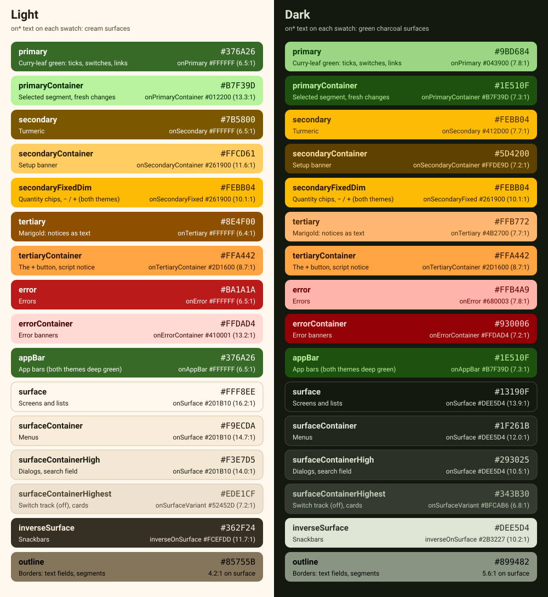

# Docs

Planning notes for Kirana List (formerly Grocery Sync), kept with the code.

| Doc | What it covers |
|---|---|
| [Feature ideas](feature-ideas.md) | 14 ranked feature ideas with evidence, effort and status, what the app already does, and what was left out and why |
| [Common Indian grocery list](indian-grocery-list.md) | 90 items graded core / common / regional from national survey data, with Hindi names and usual units; the source for the starter list and name matching |
| [Hindi glossary](hindi-glossary.md) | The words the app's Hindi texts use (1.6 onwards): pages, buttons, shop sections, sets, who and when, Share's title, and how the Hindi is written |
| [Removing the setup](zero-setup.md) | How to drop the Google Sheet + Apps Script setup (recommended: Firebase with an invite code), the migration plan, and how to get the app onto phones (sideloading, Play internal testing, public release), with a fact check of every price and policy |

## Decisions so far (2026-11-08)

1. Ship the five quick wins first, as 1.4. They change only the app, so the sheet's script stays as it is.
2. Then move off Google Sheets to Firebase (Cloud Firestore in Mumbai, anonymous sign-in, invite code) as its own release. The Cloudflare Worker + D1 option is the fallback.
3. Keep sideloading the signed APK for the family for now; move to a Play Console internal testing track when it saves effort.

## Look and name

The app is **Kirana List**, formerly Grocery Sync (a *kirana* is the neighbourhood grocery shop). Only the visible name changed: the app id `com.grocerysync.app`, the Kotlin packages, the signing key and `Code.gs` are the same, so it installs over Grocery Sync as an update. The name is `app_name` in `android/app/src/main/res/values/strings.xml`, which the list's app bar shows too; the qa build is called **Kirana QA**.

The icon is a cream *jhola* (cloth shopping bag) with a turmeric check mark on the brand green: an adaptive icon in vector drawables, with a monochrome layer for Android 13+ themed icons. The Android 12+ splash screen shows the same bag on the same green, and the app shows it too (`res/drawable/ic_jhola.xml`): turmeric in front of the name in the app bar, leaf green on an empty list.

The "fresh market" palette is in `android/app/src/main/java/com/grocerysync/app/ui/theme/Theme.kt`: three seed colours turned into Material HCT tonal palettes, mapped to complete Material 3 light and dark schemes.

| Colour | Seed | Light theme | Dark theme | Where it shows |
|---|---|---|---|---|
| Curry-leaf green (primary) | `#3E7D2A` | `#376A26`, container `#B7F39D` | `#9BD684`, container `#1E510F` | App bars, ticks, switches, the selected To buy / All items segment, links, "Live" |
| Turmeric (secondary) | `#F4B400` | `#7B5800`, container `#FFCD61`, chips `#FEBB04` | `#FEBB04`, container `#5D4200`, chips `#FEBB04` | Quantity chips and the item dialog's − / + buttons (the same bright turmeric in both themes), the bag in the app bar; the container: the setup banner |
| Marigold (tertiary) | `#F28C00` | `#8E4F00`, container `#FFA442` | `#FFB772`, container `#FFA442` | The + button, notices (the script is out of date, a web app URL warning) |
| Surfaces | | Warm cream `#FFF8EE`; dialogs `#F3E7D5` | Green charcoal `#13190F`; dialogs `#293025` | Screens, menus, dialogs |
| Error | | `#BA1A1A` | `#FFB4A9` | Errors stay red |

- The app bars are deep green in both themes (light `#376A26` with white text, dark `#1E510F` with `#B7F39D`), so the status bar icons over them are always light; the navigation bar follows the theme. The full-screen dialogs (Add common items, Paste a list) draw under both bars too, with the same green bar at the top.
- **Shop sections** (1.5) each have an accent, `SectionAccents` in `ui/theme/BrandColors.kt`: a short bar in front of the section's name on To buy and in Add common items, and a dot in the item dialog's Shop section picker. To buy's sticky section header is a pale tone of the same hue (OKLCH L 0.95, C 0.03), a deep one in the dark theme (L 0.29, C 0.04), so each section keeps its own colour on the cream and the charcoal. The name and count keep the usual text colours; the colour only helps the eye find a section.

  | Section | Light | Dark | | Section | Light | Dark |
  |---|---|---|---|---|---|---|
  | Sabzi & fruit (leaf) | `#4F8A39` | `#80C369` | | Dry fruits & nuts (kishmish) | `#AA678E` | `#DBA1C1` |
  | Dairy, eggs & bread (milk blue) | `#3B81B8` | `#79B8EC` | | Snacks & packaged food (slate) | `#6B7D9B` | `#A0B3D2` |
  | Meat & fish (rose) | `#C65966` | `#EE9BA0` | | Cleaning & household (teal) | `#238A85` | `#63C1BB` |
  | Atta, rice & dal (wheat) | `#98764E` | `#D0AC82` | | Personal care (lavender) | `#8B6EBC` | `#BDA7E6` |
  | Oil & ghee (mustard oil) | `#818032` | `#B7B668` | | Puja (marigold) | `#BC6603` | `#F69C51` |
  | Masala (haldi) | `#A37401` | `#E7A503` | | Other (grey) | `#807C73` | `#B5B2A7` |
  | Tea, sugar & salt (kadak chai) | `#9A5238` | `#C7856B` | | | | |

- Dynamic (wallpaper) colour is off, so the brand palette always shows. Dark mode follows the phone's setting.
- `ThemeContrastTest` (a JVM unit test) checks WCAG contrast in both themes: 4.5:1 for text and icons on their colour (every `on*` role, `onSurfaceVariant` on every surface container, a section's name and count on its tinted header), 3:1 for outlines and marks (every section's accent on its header, on the dialog and on the menu). It also keeps every two section marks at least 0.05 apart in OKLab, so none are near twins, and each header in its mark's hue.
- Screenshots of To buy in both themes: `images/screenshot-light.png`, `images/screenshot-dark.png` (shown in the main README).
